# LeafGuard: plant disease recognition from a leaf photo

Upload a photo of one leaf and get the most likely disease, a calibrated confidence, and general next steps. LeafGuard is a fine-tuned ConvNeXt-Tiny classifier trained on six public datasets, with 109 crop/condition classes and about 120,000 photos. The web app runs on CPU with ONNX Runtime.

**Live demo:** Not deployed yet. The Streamlit Community Cloud link will be added here after deployment. See [the deployment guide](docs/DEPLOYMENT.md).

The project is built around one question: **do plant-disease models that look excellent on lab photos work on real field photos?** It measures that honestly instead of reporting only the flattering number.

## Results at a glance

| Evaluation | Photos | Result |
|---|---:|---|
| Internal test set, all photos | 13,525 | 91.1% accuracy, 83.3% macro-F1, 97.5% top-3 |
| Internal test set, lab photos only | 5,452 | 99.6% accuracy |
| Internal test set, **field photos only** | 8,073 | **85.5% accuracy** |
| PlantDoc test set (held out, different source) | 223 | **70.0% accuracy** (about +/-6 points), 92.8% top-3 |
| Same PlantDoc photos, **lab-only baseline** | 223 | 34.5% accuracy |

- **Field data is what makes it work.** Adding field photos to training lifts accuracy on held-out PlantDoc photos from 34.5% to 70.0% (+35.4 points).
- **The 91% headline is inflated.** 40% of the internal test set is easier lab photography. Use the 85.5% field figure for more realistic expectations.
- **Strong blur is the main weakness.** Accuracy falls from 90.3% on clean photos to 45.9% under strong blur.
- **Confidence calibration shifts across sources.** Temperature scaling reduces internal test ECE from 0.060 to 0.023, but PlantDoc ECE rises from 0.044 to 0.115.

Full evaluation tables, robustness results, per-class analysis, and caveats are in [docs/RESULTS.md](docs/RESULTS.md). The charts below are recreated from the summary values documented there; they are not raw per-image evaluation plots.

## Evaluation charts

These summary charts make the main findings easier to scan. Their source values are listed in [`results/summary_metrics.json`](results/summary_metrics.json), with the full explanation and sample counts in [the results report](docs/RESULTS.md).

| Accuracy by evaluation set | Lab-only vs field-inclusive model |
|---|---|
| [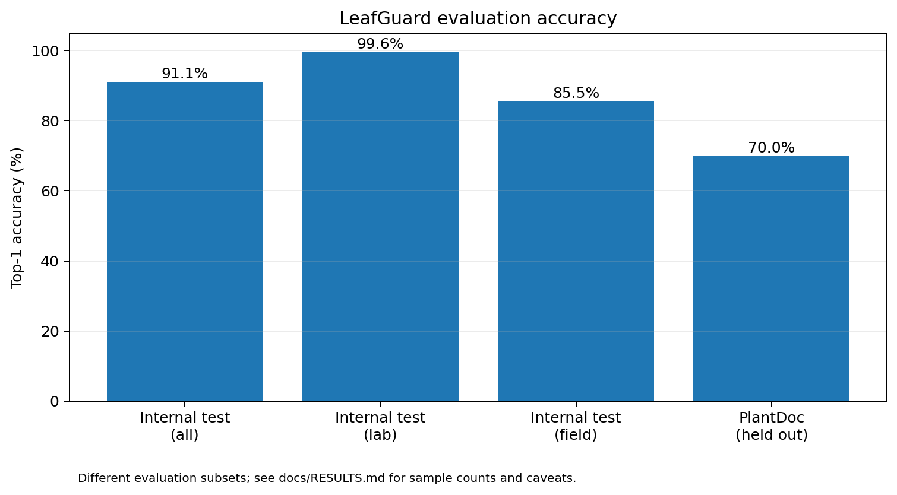](results/accuracy_summary.png) | [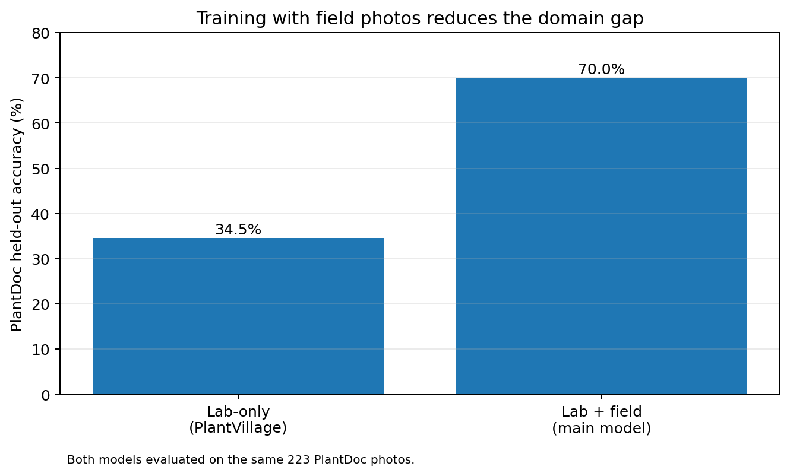](results/plantdoc_domain_gap.png) |
| Robustness under photo conditions | Calibration before and after scaling |
| [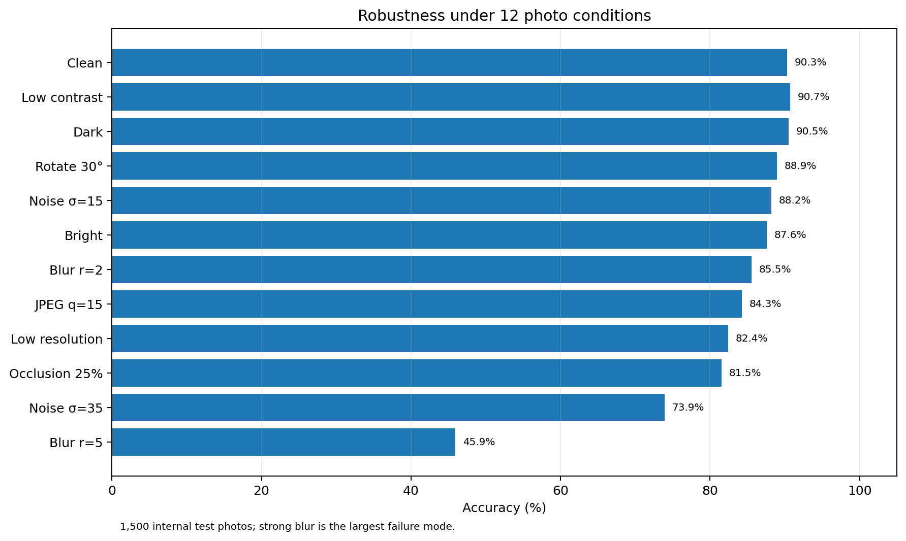](results/robustness_summary.png) | [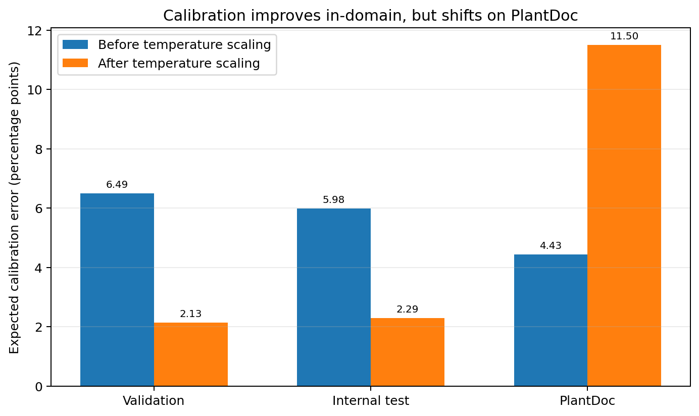](results/calibration_summary.png) |

More: [selective prediction](results/selective_prediction.png) · [CPU latency](results/cpu_latency_summary.png).

## Sample photos

The app bundles ten sample images for its **Try a sample** tab. Each thumbnail links to the original image in the repository.

| Sample | Sample |
|---|---|
| [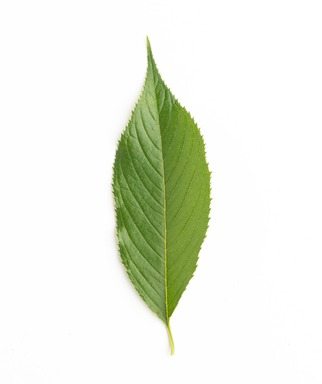](deploy/samples/cherry__healthy.jpg) **Cherry — healthy** | [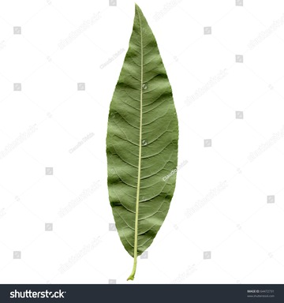](deploy/samples/peach__healthy.jpg) **Peach — healthy** |
| [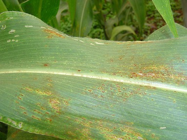](deploy/samples/corn__common_rust.jpg) **Corn — common rust** | [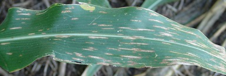](deploy/samples/corn__northern_leaf_blight.jpg) **Corn — northern leaf blight** |
| [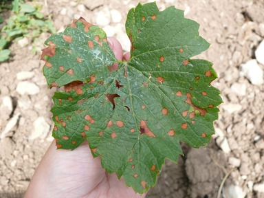](deploy/samples/grape__black_rot.jpg) **Grape — black rot** | [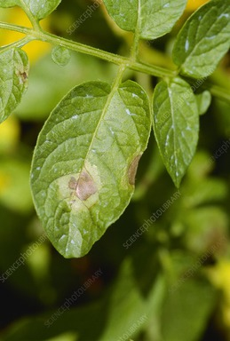](deploy/samples/potato__late_blight.jpg) **Potato — late blight** |
| [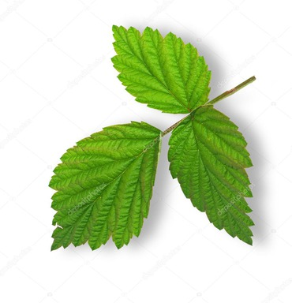](deploy/samples/raspberry__healthy.jpg) **Raspberry — healthy** | [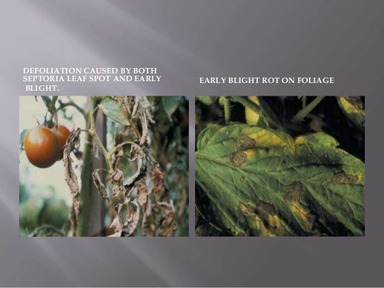](deploy/samples/tomato__early_blight.jpg) **Tomato — early blight** |
| [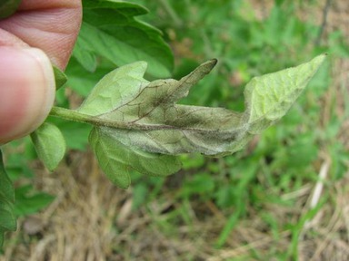](deploy/samples/tomato__late_blight.jpg) **Tomato — late blight** | [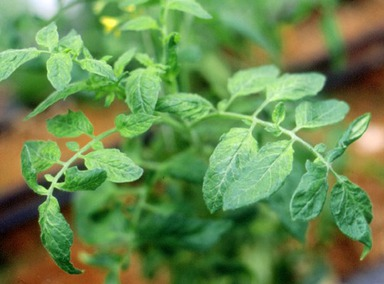](deploy/samples/tomato__mosaic_virus.jpg) **Tomato — mosaic virus** |

## Run the app

The repository includes the compact INT8 ONNX model (`deploy/model_int8.onnx`, about 28 MB), so inference does not require training or a GPU. The exported configuration contains 109 classes. The compact model agrees with the full-precision ONNX model on **97.92%** of comparison predictions.

```bash
pip install -r requirements.txt
streamlit run leafguard.py
```

The app automatically uses the compact model when `deploy/model.onnx` (full precision) is not present. The full-precision export is about 112 MB and is intentionally not included in this repository because it exceeds GitHub's regular 100 MB file limit. It is not required to run the app.

The app supports photo upload, camera capture, and the bundled sample gallery. It can show the image regions that influenced a prediction using an occlusion heatmap. Uploaded photos are processed in memory and are not stored by the app.

## Reproduce the training and evaluation

The documented training environment was Python 3.12, PyTorch 2.5.1, timm 1.0.31, an RTX 3060 (12 GB), 16 CPU threads, and 30 GB RAM.

```bash
# Install PyTorch with a suitable CPU/CUDA build first, then:
pip install -r requirements-train.txt

export LEAFGUARD_ROOT="/path/to/folder/with/datasets"
python leafguard.py check                      # environment and dataset folders
python leafguard.py prepare                    # build the unified, leak-controlled dataset
python leafguard.py train                      # fine-tune ConvNeXt-Tiny
python leafguard.py evaluate --tta             # full evaluation report
python leafguard.py export --run convnext_tiny # export ONNX model and deploy/ folder
python leafguard.py domain-gap                 # lab-only baseline vs real-world photos
python leafguard.py compare                    # table of all runs
```

The datasets are not included. See [DATASETS.md](DATASETS.md) for sources, licence notes, and the expected folder layout. All commands are in `leafguard.py`; run `python leafguard.py --help` for options.

## How it works

```text
6 datasets -> unify labels -> resize cache + image hash -> remove duplicates + leak guard -> grouped splits
           -> train -> evaluate -> export (ONNX) -> Streamlit app (CPU)
```

- **Label unification.** Different source naming styles (for example, `Tomato___Late_blight` and `tomato leaf late blight`) become one `crop__condition` class list through explicit mapping rules. The mapping is generated during preparation and can be corrected with `label_overrides.csv`.
- **Leak control.** Exact duplicates and photos with conflicting labels are removed. Training photos that closely resemble PlantDoc test photos are removed. Leaf crops from one source photo, and augmented copies of one photo, stay in the same split. PlantDoc's test set is held out from training, tuning, and model selection.
- **Splits.** PlantWild keeps its official train, validation, and test folders, and PlantDoc's train folder feeds training. Other sources use a stratified group split.
- **Model.** ConvNeXt-Tiny pre-trained on ImageNet, 224 px input. Training uses AdamW, a cosine schedule, label smoothing, dropout, stochastic depth, EMA weights, and mixed precision. The checkpoint is selected on validation macro-F1.
- **Confidence.** Temperature scaling and an abstain threshold are fitted on field-photo validation data. The app declines to name a disease below the threshold.
- **Evaluation.** Accuracy, macro-F1, top-k, ROC-AUC, mAP, calibration, selective prediction, per-source and per-class breakdowns, robustness, Grad-CAM, error analysis, and inference speed.

Details: [docs/METHODOLOGY.md](docs/METHODOLOGY.md). Deployment: [docs/DEPLOYMENT.md](docs/DEPLOYMENT.md).

## Repository layout

```text
leafguard.py             training/evaluation pipeline and Streamlit app
deploy/                  109-class config, INT8 ONNX model, sample photos
  model_config.json
  model_int8.onnx
  SHA256SUMS
  samples/
docs/                    methodology, results, and deployment guide
results/                 curated metrics and summary charts
tests/                   unit and end-to-end tests
scripts/                 result collection, chart generation, and package checks
.github/workflows/       automated test workflow
MODEL_CARD.md            intended use, data, metrics, and limitations
DATASETS.md               dataset sources, licence notes, and folder layout
requirements.txt         lightweight app dependencies
requirements-train.txt   training and evaluation dependencies
```

Generated checkpoints, datasets, full-precision weights, and bulky per-run evaluation artifacts are intentionally excluded. The reported evaluation summary is documented in `docs/RESULTS.md`. Run `python scripts/verify_package.py` to check the deployment files and local documentation links before publishing.

## Limitations

- **A real-world gap remains.** Accuracy is about 85.5% on the internal field-photo subset and about 70% on the held-out PlantDoc test set. Performance on other crops, varieties, cameras, and countries may be lower.
- **Blur breaks it.** Strong blur sharply reduces accuracy. Retake blurry photos.
- **No "not a plant" class.** The confidence check rejects many unrelated photos, not all.
- **The abstain rule transfers imperfectly.** On PlantDoc the app answers 62.8% of photos at 83.6% accuracy, below the 95% target set on validation data.
- **Small classes are noisy.** Many classes have fewer than 25 test photos, so their scores can swing substantially.
- **Look-alike diseases get confused**, for example corn northern leaf blight vs gray leaf spot, and early vs late blight.
- **Treatment text is general guidance**, not a prescription. Confirm with a local agricultural extension officer.

## Licence and credits

Code: [MIT](LICENSE). Model weights and data have separate terms: several source datasets are non-commercial, so treat the model as research and education use. See [MODEL_CARD.md](MODEL_CARD.md) and [DATASETS.md](DATASETS.md).

Datasets: PlantVillage (Hughes and Salathe, 2015), PlantDoc (Singh et al., CoDS-COMAD 2020), PlantWild (Wei et al., 2024), FieldPlant (Moupojou et al., IEEE Access 2023), Cassava Leaf Disease Classification, and Plant Pathology 2021 (Kaggle competitions). Built with PyTorch, timm, ONNX Runtime, and Streamlit. ConvNeXt: Liu et al., 2022. Grad-CAM: Selvaraju et al., 2017. Temperature scaling: Guo et al., 2017.

To cite this project, use [CITATION.cff](CITATION.cff).
